# WhatsApp Business Setup & Customer Communication Management

**Project 01 | Business Operations & Digital Solutions**

**Project Overview**

This project demonstrates the setup and configuration of a WhatsApp Business profile to create a more professional, organised and accessible customer communication channel.

The objective was to establish a practical business communication system that makes it easier for potential clients to discover services, make enquiries, receive information and maintain contact.

This was a self-initiated project using my own business profile as a practical implementation and learning exercise.

## Live Demonstration

Explore the live WhatsApp Business profile and service catalogue or start a conversation directly. 

## View WhatsApp Business Profile

(https://wa.me/message/EH5EIYA6LOKPK1)

**Business Objective**

Businesses often rely on WhatsApp to communicate with customers, but without a structured setup, enquiries, follow-ups and customer communication can become difficult to manage.

The aim was to use the available WhatsApp Business features to:

- Establish a professional business presence.
- Present services clearly to potential customers.
- Make it easier for customers to initiate enquiries.
- Improve consistency in customer communication.
- Organise conversations and business contacts.
- Reduce repetitive manual responses.
- Create a more structured customer enquiry process.

**Tools & Platform**

- WhatsApp Business
- WhatsApp Business Catalogue
- Custom Chat Lists
- Quick Replies
- Automated Greeting and Away Messages
- WhatsApp Short Links

# Implementation

**1. Business Profile Setup**

Configured a professional business profile with business information, description, contact details, website and operating information.

**2. Service Catalogue**

Created a service catalogue to present business administration, virtual assistance, website support, e-commerce, digital presence, workflow improvement, AI and automation support, research and basic OHS documentation services.

**3. Customer Communication**

Configured greeting and away messages to provide consistent communication when customers first make contact or when the business is unavailable.

**4. Quick Replies**

Created reusable message templates for common enquiries, service information, quotations, remote support, follow-ups and customer appreciation.

**5. Customer & Contact Organisation**

Created custom chat lists to organise business conversations and contacts into useful categories, including:

- New Enquiries
- Potential Clients
- Quotations Sent
- Awaiting Feedback
- Active Clients
- Ongoing Support
- Completed Projects
- Follow-ups
- Recruiters
- Job Opportunities
- Business Networking
- Suppliers & Partners
- International Contacts

**6. Direct Enquiry Access**

Set up a WhatsApp short link to make it easier for potential customers to start a conversation directly from the business website and other digital platforms.

# Business Benefits

The completed setup provides a more structured approach to:

- Presenting business services professionally.
- Making contact and enquiries easier.
- Improving consistency in customer responses.
- Organising conversations and contacts.
- Managing potential customer enquiries and follow-ups.
- Supporting day-to-day business communication.

# Skills Demonstrated

- Business administration and organisation
- Customer communication management
- Digital business setup
- Service presentation
- Customer enquiry management
- Workflow organisation
- Practical problem-solving
- Research and implementation of digital tools

# Project Status

Completed – Initial Implementation

This project forms part of an ongoing portfolio demonstrating practical business solutions, digital tools, operational support and ways to improve everyday business processes.

---

This is an independent portfolio project based on my own business setup. It demonstrates practical implementation of existing platform features, rather than the development of custom software.

## Project Screenshots

The following screenshots demonstrate the configuration and implementation of the WhatsApp Business profile and its customer communication features.

**1.Business Profile**

The business profile was configured to establish a professional online presence, with business information, contact details and operation information.

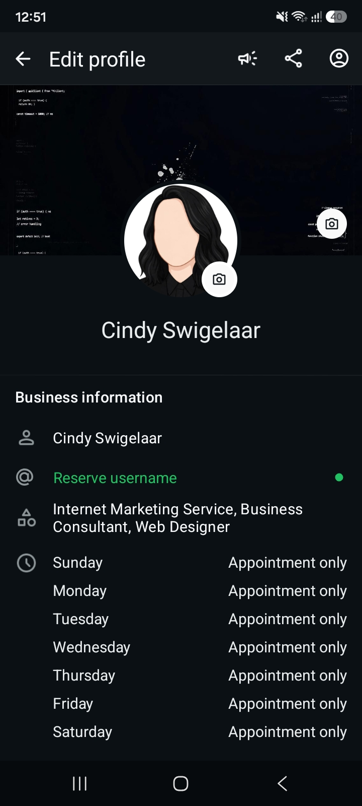

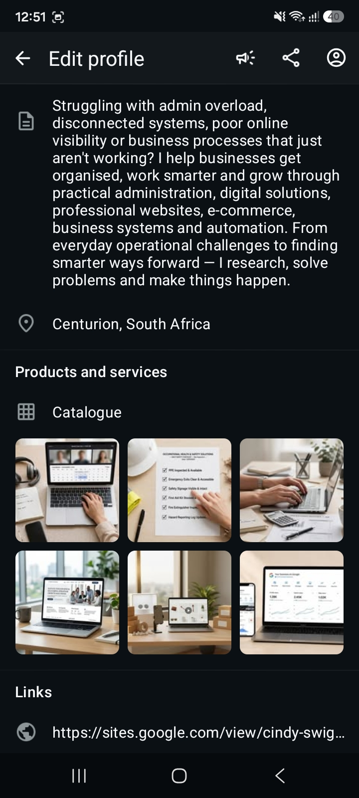

**2. Service Catalogue**

A service catalogue was created to present the available services and make it easier for potential customers to understand what the business offers.

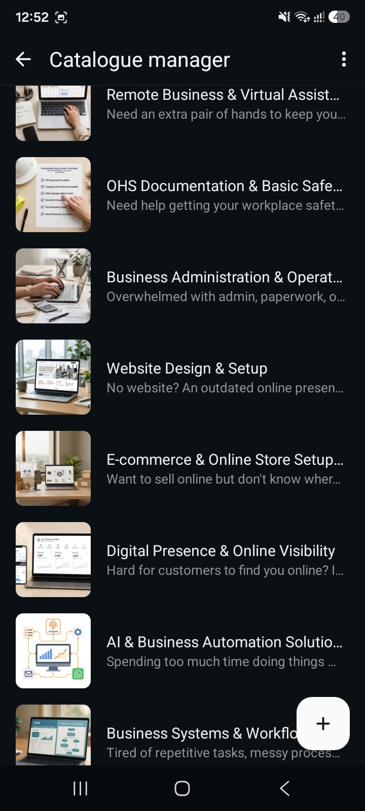

**3. Quick Replies**

Reusable message templates were created to improve response consistency and reduce repetitive typing when handling common customer enquiries.

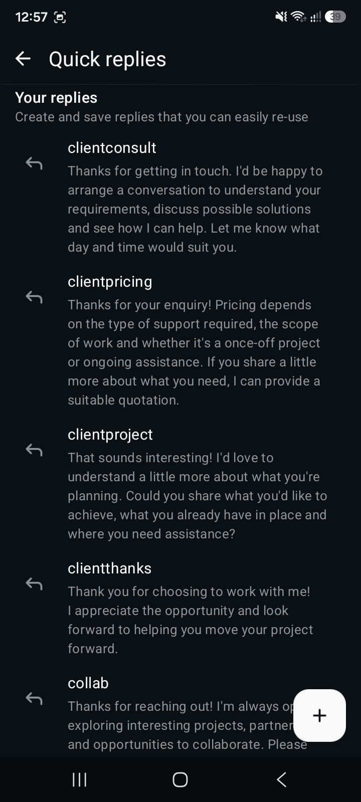

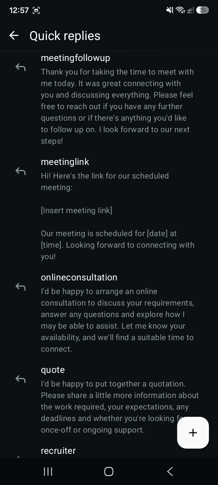

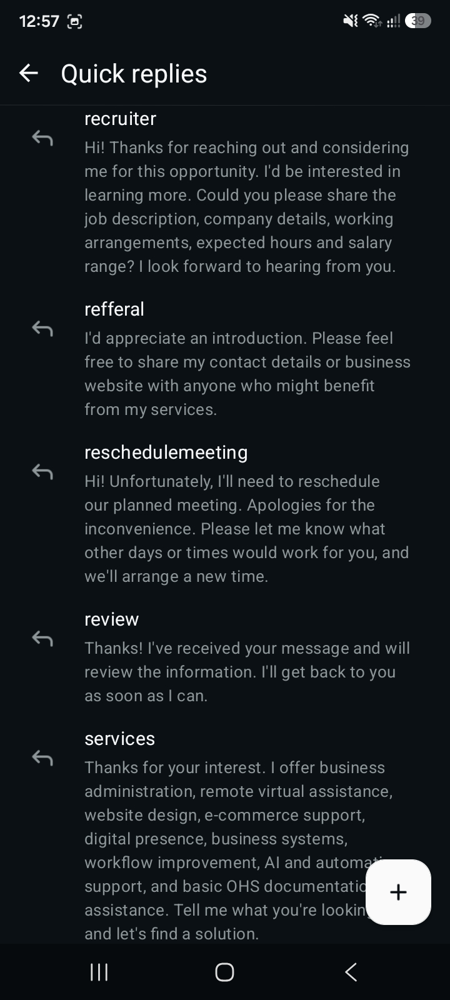

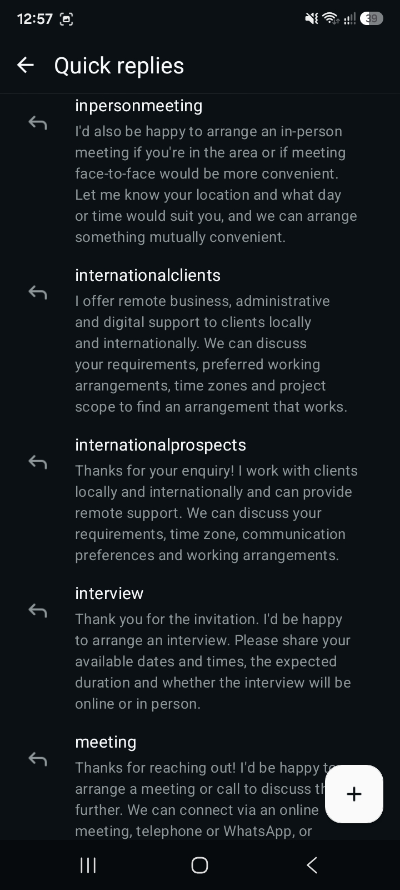

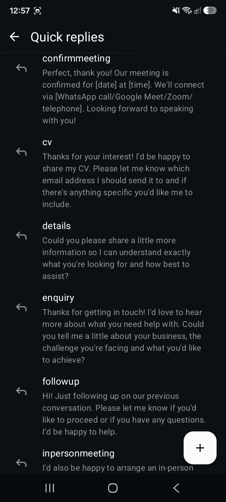

**4. Customer Lists**

Custom lists were created to organise business enquiries, potential clients, active customers, follow-ups, recruiters, leads and other important contacts.

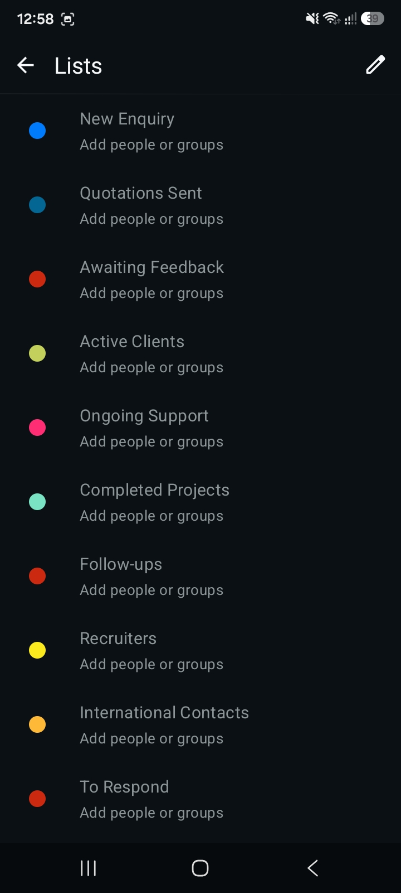

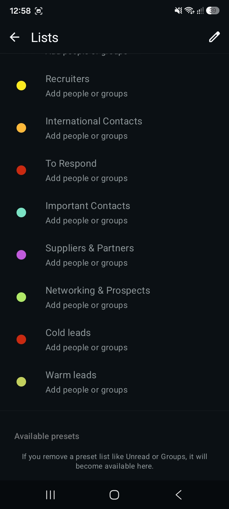

**5. WhatsApp Business Short Link**

A direct WhatsApp link was configured to make it easier for potential customers to initiate convervesations.

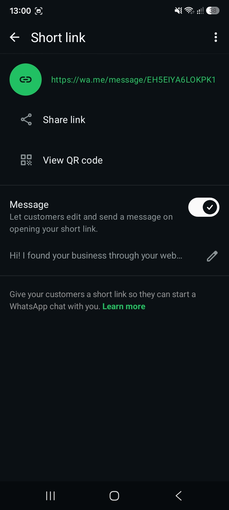

**6. Greeting Message**

A customised greeting message was configured to welcome new enquiries and introduce the business services.

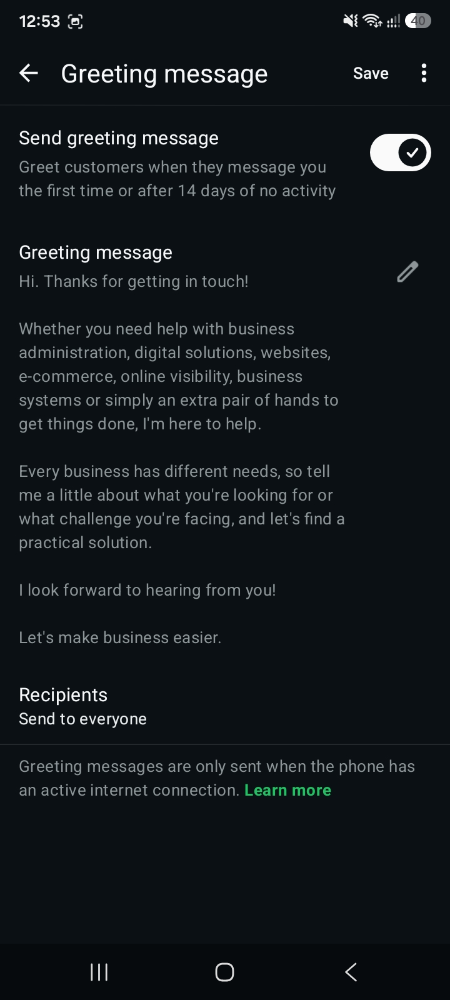

**7. Away Message**

An automated away message was configured to acknowledge incoming messages when the business is unavailable.

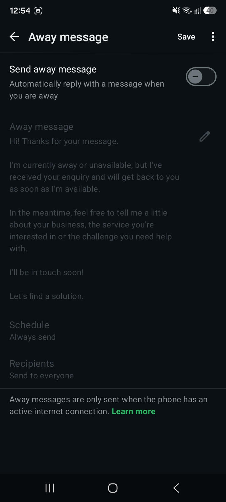

**8. Reserved Username**

A business username was reserved as part of establishing a consistent digital business identity. 

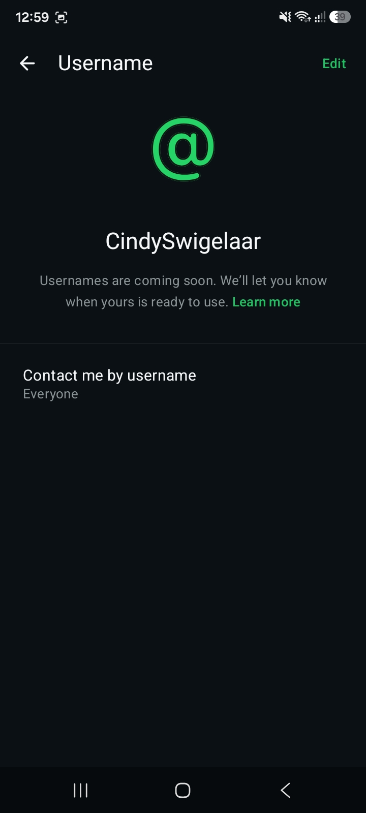

